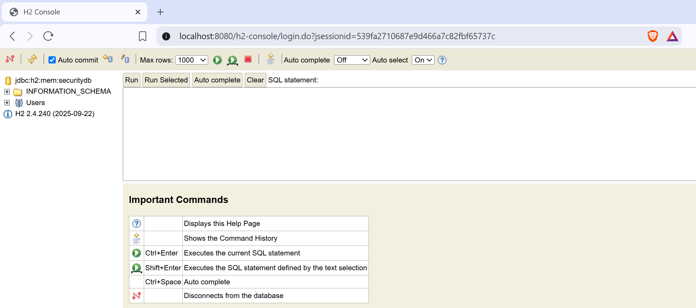
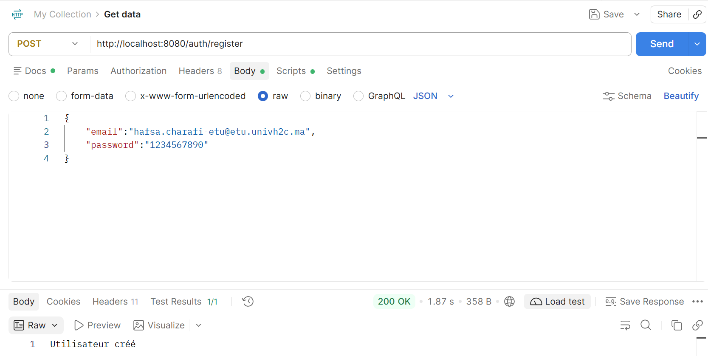
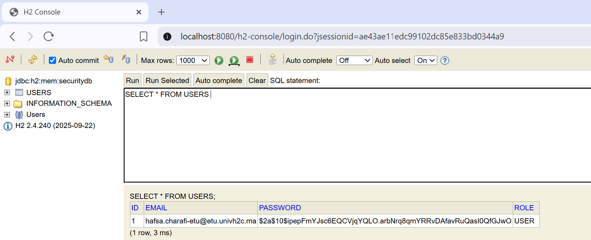
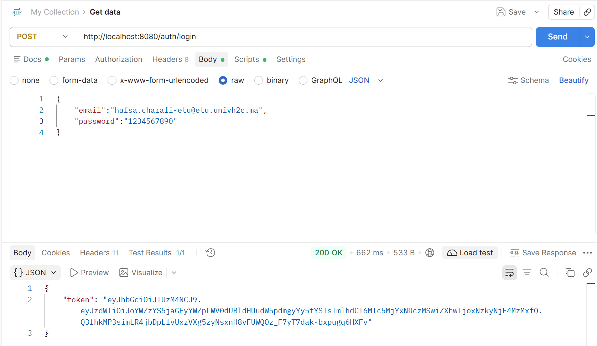
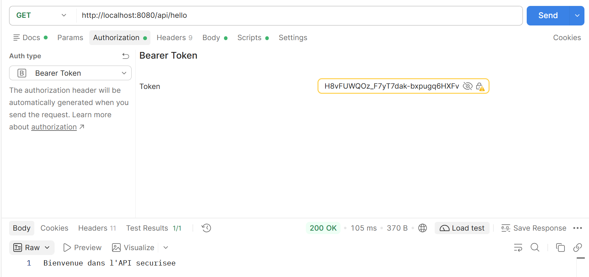
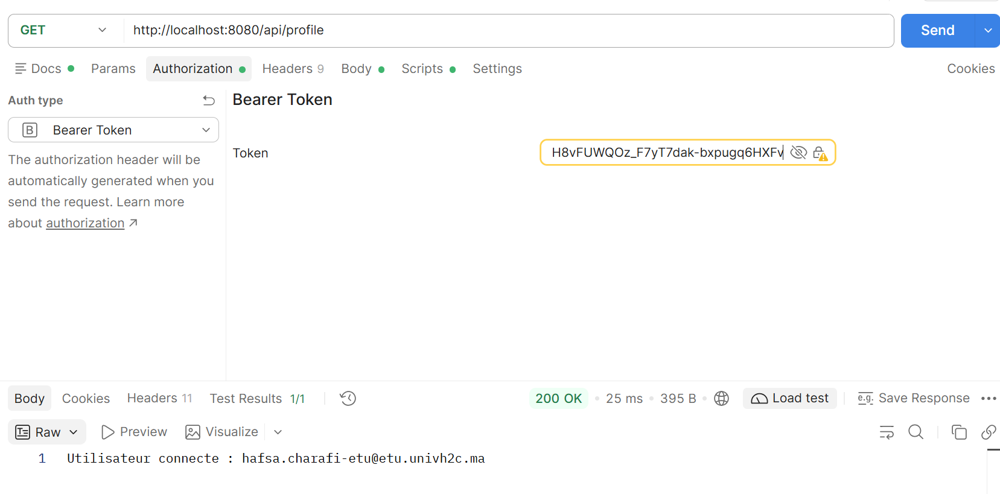
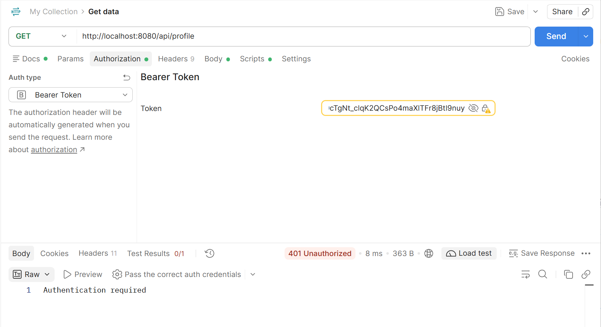

# TP2 — Authentification et sécurisation d’une API REST avec JWT

## 1. Présentation du projet

Ce projet a pour objectif de mettre en place un mécanisme d’authentification et de sécurisation d’une API REST avec **Spring Boot, Spring Security et JSON Web Token (JWT)**.

Il permet de gérer l’inscription des utilisateurs, leur authentification et l’accès aux ressources protégées. Les tests sont réalisés avec Postman, et les utilisateurs sont stockés dans une base de données H2.

## 2. Technologies utilisées

- **Java 21** : langage de programmation.
- **Spring Boot** : développement de l’application backend.
- **Spring Security** : gestion de l’authentification et des autorisations.
- **JWT (JSON Web Token)** : authentification par jeton.
- **Spring Data JPA / Hibernate** : persistance des données.
- **H2 Database** : base de données relationnelle.
- **Postman** : tests des endpoints de l’API.
- **Maven** : gestion des dépendances et construction du projet.

## 3. Fonctionnalités réalisées

- Inscription d’un nouvel utilisateur.
- Enregistrement et consultation des utilisateurs dans la base de données.
- Authentification avec les identifiants de l’utilisateur.
- Génération d’un token JWT après une authentification réussie.
- Accès aux endpoints protégés avec un token valide.
- Refus d’accès lorsque le token est modifié et n’est plus valide.

## 4. Captures d’écran des tests

Les captures suivantes illustrent le fonctionnement de l’application et les tests réalisés.

### 4.1. Connexion à la base de données H2

Vérification de la connexion à la base de données à l’aide de la console H2.



### 4.2. Inscription d’un utilisateur avec Postman

Envoi d’une requête d’inscription depuis Postman et vérification de la réponse de l’API.



### 4.3. Consultation des utilisateurs dans la base de données

Exécution d’une requête SQL pour vérifier que l’utilisateur inscrit a bien été enregistré.



### 4.4. Authentification avec Postman

Envoi des identifiants de l’utilisateur et vérification de la réponse contenant le token JWT.



### 4.5. Accès réussi à l’endpoint `/hello`

Envoi d’une requête vers une ressource protégée avec un token JWT valide. L’accès est autorisé.



### 4.6. Accès à l’endpoint `/api/profil`

Test de l’accès au profil de l’utilisateur avec un token JWT valide.



### 4.7. Refus d’accès avec un token JWT modifié

Modification du token JWT, puis nouvelle tentative d’accès à une ressource protégée. Le serveur rejette le token invalide et refuse l’accès à la ressource.



## 5. Configuration et exécution

### Prérequis

- JDK 21
- Maven ou Maven Wrapper
- Un outil de test d’API tel que Postman

### Lancer l’application

Cloner le dépôt :

```bash
git clone <URL_DU_DEPOT>
cd <NOM_DU_PROJET>
```

Démarrer l’application sous Windows :

```powershell
.\mvnw.cmd spring-boot:run
```

L’application démarre par défaut sur :

```text
http://localhost:8080
```

### Accéder à la console H2

Lorsque l’application est démarrée, ouvrir :

```text
http://localhost:8080/h2-console
```

Paramètres de connexion utilisés dans ce projet :

- **JDBC URL :** `jdbc:h2:mem:securitydb`
- **Username :** `ccn`
- **Password :** vide

La base H2 étant configurée en mémoire, les données peuvent être perdues à l’arrêt de l’application.

## 6. Conclusion

Ce TP m’a permis de mettre en pratique la sécurisation d’une API REST avec Spring Security et JWT. Les tests réalisés permettent de vérifier l’inscription des utilisateurs, leur authentification, l’accès aux ressources protégées et le rejet d’un token modifié.

